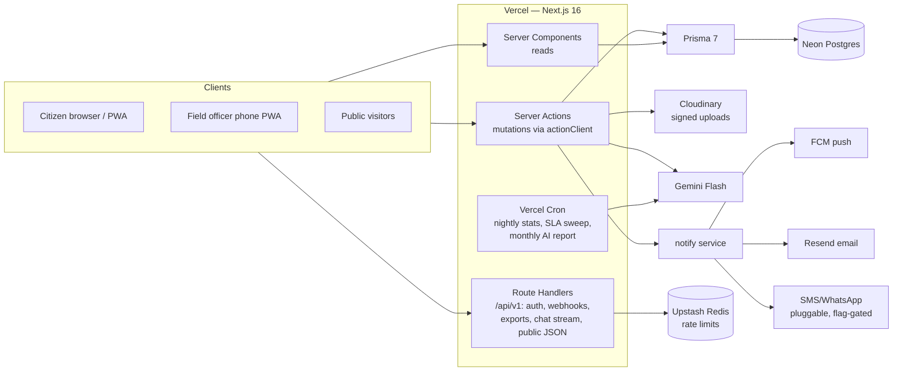

# 02 — System Architecture

## 1. High-level architecture

One Next.js 16 app on Vercel is the entire backend and frontend. No separate API
service — Server Components read, Server Actions write, Route Handlers exist only for
webhooks, public JSON, exports, auth, and the chatbot stream.



**Complaint submission lifecycle** (the flow everything else hangs off):

1. Client: RHF + Zod form → media pre-uploaded to Cloudinary with a signed signature from `POST /api/v1/uploads/sign`.
2. Server Action `submitComplaint` (actionClient: Zod → auth → rate limit → audit): creates `Complaint` (status SUBMITTED) + `Media` + `TimelineEntry(SUBMITTED)` in one transaction; resolves ward from lat/lng point-in-polygon against ward boundaries.
3. `after()` (non-blocking): AI intake call → writes category/department/priority/sentiment/language + `TimelineEntry(AI_ACTION)`; duplicate check (same category within 150 m / 30 days → flag for staff merge); `notify('complaint.submitted')`.
4. AI failure ⇒ complaint lands in the manual "Unclassified" triage tab. Core flow never blocks on AI.
5. Staff/officer transitions run the same pattern: transaction (status + timeline) → `after()` (notify, AI assists).

**Status transitions** are enforced by a single map in `features/complaints/lib/workflow.ts`:
`ALLOWED: Record<ComplaintStatus, ComplaintStatus[]>` + `canTransition(role, from, to)`. All
transition actions call it; illegal transitions are impossible, not just hidden in the UI.

**Realtime:** none at launch. In-app notification bell polls every 30 s (SWR); complaint
detail revalidates on focus. Upgrade path: SSE route or Pusher — listed in 06 §future.

## 2. Folder structure (feature-first)

```
src/
├─ app/
│  ├─ (public)/                 # no auth: home, action-dashboard, map, stories,
│  │                            # announcements, schemes, gallery, faq, contact,
│  │                            # track/[code]
│  ├─ (auth)/                   # login, otp, onboarding
│  ├─ (citizen)/dashboard/      # citizen: raise, my-complaints, drafts, appointments,
│  │                            # polls, suggestions, volunteer, profile, settings
│  ├─ (office)/office/          # staff+admin: triage, complaints, assignments, sla,
│  │                            # analytics, reports, content/*, admin/* (users, wards,
│  │                            # departments, settings, audit)
│  ├─ (department)/department/  # dept officer queues + analytics
│  ├─ (field)/field/            # field officer mobile-first PWA views
│  ├─ api/
│  │  ├─ auth/[...all]/         # Better Auth handler
│  │  └─ v1/                    # uploads/sign, chat, notifications/token, webhooks/*,
│  │                            # public/*, reports/export, cron/*
│  ├─ layout.tsx  globals.css  manifest.ts  sitemap.ts
├─ features/                    # one folder per domain — components, actions.ts,
│  │                            # queries.ts, schemas.ts, types.ts live together
│  ├─ complaints/  (+ lib/workflow.ts, lib/geo.ts)
│  ├─ triage/  timeline/  media/  notifications/  appointments/
│  ├─ engagement/               # polls, suggestions, volunteers, callbacks
│  ├─ public-site/              # stories, projects, action-stats, announcements, schemes
│  ├─ analytics/  reports/  chat/  admin/
├─ components/
│  ├─ ui/                       # shadcn primitives
│  └─ shared/                   # AppShell, DataTable, MapView, MediaUploader, Timeline,
│                               # EmptyState, StatCard, CommandPalette, ThemeToggle …
├─ lib/
│  ├─ auth/                     # better-auth config, requireUser(), permissions.ts (RBAC)
│  ├─ db.ts                     # Prisma singleton (PrismaPg adapter)
│  ├─ safe-action.ts            # actionClient: Zod → session → RBAC → ratelimit → audit
│  ├─ ai/                       # gemini.ts client + intake.ts, chat.ts, reports.ts, media.ts
│  ├─ notify/                   # notify() + channels/{inapp,push,email,sms}.ts + events.ts
│  ├─ cloudinary.ts  ratelimit.ts  audit.ts  env.ts (Zod-validated env)
├─ hooks/        # useMediaRecorder, useGeolocation, useNotifications, useShortcuts
├─ providers/    # theme, toast (sonner), command palette, query provider
├─ i18n/         # next-intl messages: en.json, <regional>.json
├─ constants/    # categories, status labels/colors, shortcuts, nav per role
├─ types/        # global types only — feature types live in their feature
└─ styles/
prisma/           # schema.prisma + migrations + seed.ts
```

Rules: features never import from other features' internals (shared code moves to
`lib/` or `components/shared`); `app/` routes are thin — they compose feature components.

## 3. State management

| State | Where | How |
|---|---|---|
| Server data (complaints, analytics…) | Server | RSC reads via `features/*/queries.ts`; mutations = server actions + `revalidatePath`/`revalidateTag` |
| Filters, tabs, pagination, search | URL | `searchParams` — shareable, back-button-safe, no store |
| Forms | Local | React Hook Form + Zod resolver; multi-step raise-form persists to a draft complaint row per step |
| Theme, command palette, toasts | Context | next-themes, cmdk provider, sonner |
| Notification bell | SWR | 30 s poll of unread count |
| Ephemeral UI | `useState` | — |

**No Redux/Zustand/Jotai.** The server is the store. Add a client cache only if a
measured need appears.

## 4. Authentication flow (Better Auth)

- **Providers:** phone OTP (primary; SMS via pluggable provider — console in dev, MSG91 in prod) + Google OAuth. Email optional on profile.
- **Sessions:** DB-backed httpOnly cookie, `sameSite=lax`, `secure` in prod; 30-day sliding expiry with rotation — this replaces hand-rolled JWT+refresh and is strictly safer. (Bearer JWT for a future mobile app is a Better Auth plugin — future enhancement.)
- **Flow:** phone → OTP (rate-limited 3/10 min) → verify → if new user: onboarding (name, ward, language) → role-based redirect (`CITIZEN→/dashboard`, staff→/office, dept→/department, field→/field).
- **Route protection:** proxy (Next 16 middleware) does a cheap cookie check per route group; **real enforcement** is `requireUser(permission?)` in every layout and inside `actionClient` for every mutation. UI hides what the server already forbids.
- **RBAC:** `lib/auth/permissions.ts` exports `PERMISSIONS: Record<Role, Permission[]>` mirroring the matrix in 01 §3. One file, one source of truth.

## 5. AI architecture (Gemini Flash)

All AI lives behind typed functions in `lib/ai/` — the rest of the app never sees a
prompt. Every function: Zod-parsed structured output, 10 s timeout, one retry, then
deterministic fallback. Feature-flagged globally (`AI_ENABLED`).

| Capability | Trigger | Mechanism | Fallback |
|---|---|---|---|
| Categorize + department + priority + sentiment + language + title cleanup | `after()` submit | **One** structured-output call (single JSON schema — not six calls) | Unclassified triage tab |
| Duplicate detection | `after()` submit | SQL first (same category, ≤150 m, ≤30 days) → Gemini confirms text similarity on candidates only | Staff merge tool |
| Voice → text | Voice note upload | Gemini audio transcription → editable text in form | Audio attached as-is |
| Translation | On demand (button) | Translate complaint/response, cached on row | Show original |
| Suggested response | Officer opens reply box | Draft from complaint + timeline; officer edits, never auto-sends | Empty box |
| FAQ chatbot | `/api/v1/chat` (streaming) | System prompt grounded in FAQs + schemes + rep profile; answers only from context; escalates to "raise a complaint" CTA | Static FAQ page |
| Monthly summary, ward analysis | Cron (monthly) | SQL aggregates → Gemini narrative → stored as `Report` row, human-reviewed | Tables without narrative |
| Predictive hotspots | Cron (weekly) | **SQL does the detecting** (ward × category × 8-week trend); Gemini only phrases the finding | Raw trend table |
| Impact-story draft | Staff clicks "Draft story" on a closed complaint/project | Draft from timeline + before/after; always human-reviewed before publish | Manual write |

Cost control: Flash model, single intake call per complaint, chat rate-limited
10 msg/min/user, translations cached. At 2k complaints/month this is single-digit $/mo.

## 6. Notification architecture

One entry point: `notify(event, payload)` — nobody talks to a channel directly.

```
notify('complaint.status_changed', { complaintId, to })
  → events.ts: recipients (owner/followers/role) + template + default channels
  → per-user preference filter (User.notificationPrefs)
  → fan out: inapp.ts (Notification row — always)
            push.ts  (FCM to User.fcmTokens; prune dead tokens on error)
            email.ts (Resend + react-email template)
            sms.ts / whatsapp.ts (same interface, behind feature flags — Phase 2+)
```

- Runs in `after()` — fire-and-forget, failures logged to AuditLog, never block the mutation. Volume ceiling: if fan-out ever exceeds serverless limits, swap the internals for QStash/Inngest — the `notify()` signature doesn't change.
- FCM web push: service worker + token registration (`POST /api/v1/notifications/token`), tokens stored on User.
- Digest cron (daily 8 am): unread summary email for staff; SLA-breach warnings to Admin.

## 7. Deployment architecture

```
GitHub → PR → GitHub Actions (lint, typecheck, vitest, prisma migrate diff)
        → Vercel Preview (Neon branch DB per preview)
   main → Vercel Production (prisma migrate deploy in build) → Neon main
```

- **Services:** Vercel (app + cron), Neon Postgres, Cloudinary, Upstash Redis, FCM, Resend, Gemini API, SMS provider (prod only).
- **Cron (vercel.json):** nightly action-stats recompute + auto-close (7-day confirm window) + SLA sweep; weekly hotspots; monthly AI report.
- **Env:** all vars validated at boot by `lib/env.ts` (Zod) — fail fast, listed in `.env.example`. Secrets only in Vercel env; nothing `NEXT_PUBLIC_` unless truly public.
- **Observability:** Vercel Analytics + Sentry (Phase 6); AuditLog covers the domain trail from Phase 1.

## 8. Security architecture

| Threat | Control |
|---|---|
| Injection | Prisma parameterized queries; the two report queries that must interpolate a column name or keyword are constrained by a runtime allowlist |
| XSS | React escaping; one `dangerouslySetInnerHTML` (JSON-LD, escaped); no rich text — if it is ever added it must be sanitized (rehype-sanitize); CSP headers in `next.config` |
| CSRF | Better Auth origin checks + `sameSite` cookies + Next server-action origin validation |
| Broken access control | RBAC in `defineAction` (`lib/safe-action.ts`, called `actionClient` elsewhere in these docs) on **every** mutation + `requireUser` in every protected layout; object-level checks (citizen sees own complaints; dept officer scoped to department; field officer to assignments) |
| Brute force / abuse | Upstash rate limits: OTP 3/10 min/phone, login 10/hr/IP, complaint submit 5/day/user, chat 10/min/user, public API 60/min/IP |
| Malicious uploads | Cloudinary **signed** uploads only; the signature pins folder and resource type; attached URLs must be in our own cloud; size (img ≤ 10 MB, video ≤ 100 MB, audio ≤ 20 MB) and MIME are client-reported and advisory until an upload preset with `max_file_size` exists; EXIF stripped on public renders (GPS kept server-side for geo-verification) |
| PII exposure | Public map: jittered coords, no names; phones masked outside staff views; private-complaint flag; citizens see officer name/designation only |
| Tampering / repudiation | AuditLog on every mutation via actionClient (actor, action, entity, ip, meta); timeline is append-only — no update/delete path exposed |
| Secrets | Zod-validated env, Vercel-managed, never client-bundled |
| Transport/headers | HSTS, X-Frame-Options DENY, nosniff, referrer-policy, minimal CSP — one block in `next.config` |
| Session theft | httpOnly + secure + rotation; logout-all-devices in settings |

Validation doctrine: **client Zod for UX, server Zod for truth** — the same schema
imported from `features/*/schemas.ts`, parsed again inside every action and route handler.
