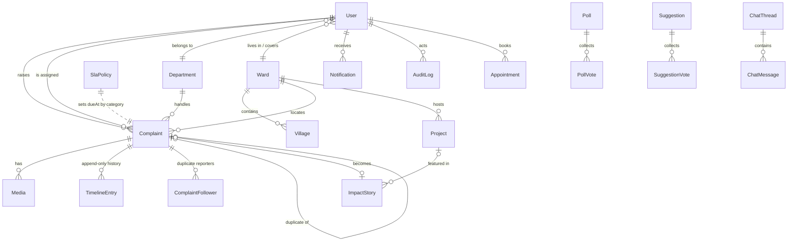

# 03 — Database Schema (Prisma / PostgreSQL)

Single source of truth for the data model. Copy into `prisma/schema.prisma` at Phase 0
(Better Auth's CLI will additionally generate its `Session`/`Account`/`Verification`
models against the same `User`).

Design notes:
- **Geo:** plain `Float` lat/lng + B-tree index. PostGIS/pgvector are future enhancements — point-in-polygon for ward resolution runs in JS against stored GeoJSON (wards ≈ dozens, not thousands).
- **Feedback** lives on `Complaint` (one per complaint). **Drafts** are `Complaint` rows with status `DRAFT`. Fewer tables, same power.
- All enums are Postgres enums; all FKs indexed; timestamps everywhere.

```prisma
generator client {
  provider = "prisma-client-js"
}

datasource db {
  provider = "postgresql"
  url      = env("DATABASE_URL")
}

// ───────────────────────── Enums ─────────────────────────

enum Role {
  CITIZEN
  OFFICE_STAFF
  DEPARTMENT_OFFICER
  FIELD_OFFICER
  REPRESENTATIVE
  ADMIN
  SUPER_ADMIN
}

enum RepresentativeType {
  MLA
  MP
  COUNCILLOR
}

enum ComplaintCategory {
  ROAD
  DRAINAGE
  STREET_LIGHT
  WATER
  ELECTRICITY
  GARBAGE
  SCHOOL
  HOSPITAL
  PENSION
  HOUSING
  PUBLIC_SAFETY
  TRANSPORT
  AGRICULTURE
  ENVIRONMENT
  OTHER
}

enum ComplaintStatus {
  DRAFT
  SUBMITTED
  ACKNOWLEDGED
  ASSIGNED
  DEPT_REVIEW
  FIELD_VERIFICATION
  IN_PROGRESS
  COMPLETED   // awaiting citizen confirmation (7-day window)
  CLOSED
  REJECTED
  REOPENED
}

enum Priority {
  LOW
  MEDIUM
  HIGH
  URGENT
}

enum Sentiment {
  POSITIVE
  NEUTRAL
  NEGATIVE
  ANGRY
}

enum MediaKind {
  IMAGE
  VIDEO
  AUDIO
  DOCUMENT
}

enum MediaStage {
  SUBMISSION
  VERIFICATION
  PROGRESS
  RESOLUTION
  SIGNATURE
}

enum TimelineType {
  STATUS_CHANGE
  ASSIGNMENT
  COMMENT
  MEDIA_ADDED
  AI_ACTION
  FEEDBACK
  ESCALATION
  MERGE
}

enum AppointmentStatus {
  REQUESTED
  CONFIRMED
  COMPLETED
  CANCELLED
}

enum CallbackStatus {
  PENDING
  DONE
}

enum ProjectStatus {
  PLANNED
  ONGOING
  COMPLETED
}

enum SuggestionStatus {
  OPEN
  CONSIDERED
  ADOPTED
  DECLINED
}

enum VolunteerStatus {
  PENDING
  APPROVED
  INACTIVE
}

enum ChatThreadStatus {
  OPEN
  CLOSED
}

// ─────────────────────── Core people ───────────────────────

model User {
  id            String   @id @default(cuid())
  phone         String?  @unique
  email         String?  @unique
  name          String
  image         String?
  role          Role     @default(CITIZEN)
  language      String   @default("en")
  wardId        String?               // citizen home ward / officer jurisdiction
  departmentId  String?               // for DEPARTMENT_OFFICER / FIELD_OFFICER
  fcmTokens     String[] @default([])
  notificationPrefs Json?             // { push: true, email: true, sms: false, ... }
  isActive      Boolean  @default(true)
  createdAt     DateTime @default(now())
  updatedAt     DateTime @updatedAt

  ward              Ward?        @relation(fields: [wardId], references: [id])
  department        Department?  @relation(fields: [departmentId], references: [id])
  complaints        Complaint[]  @relation("ComplaintCitizen")
  assignedComplaints Complaint[] @relation("ComplaintAssignee")
  timelineEntries   TimelineEntry[]
  notifications     Notification[]
  appointments      Appointment[]
  callbackRequests  CallbackRequest[]
  pollVotes         PollVote[]
  suggestions       Suggestion[]
  suggestionVotes   SuggestionVote[]
  volunteer         Volunteer?
  media             Media[]
  auditLogs         AuditLog[]
  announcements     Announcement[]
  chatThreads       ChatThread[] @relation("ThreadCitizen")
  chatMessages      ChatMessage[]
  complaintFollows  ComplaintFollower[]

  @@index([role])
  @@index([departmentId])
  @@index([wardId])
}

// One row per deployment (single-tenant). Public-profile content.
model Representative {
  id               String             @id @default(cuid())
  name             String
  type             RepresentativeType
  constituencyName String
  party            String?
  photo            String?
  bio              String
  vision           String
  achievements     Json?              // [{year, title, description}]
  socials          Json?              // {twitter, facebook, ...}
  contactEmail     String?
  contactPhone     String?
  officeAddress    String?
  officeHours      String?
  emergencyContacts Json?             // [{label, phone}]
  updatedAt        DateTime           @updatedAt
}

// ─────────────────────── Geography ───────────────────────

model Ward {
  id        String  @id @default(cuid())
  number    Int     @unique
  name      String
  boundary  Json?   // GeoJSON polygon — map overlay + point-in-polygon ward resolution
  villages  Village[]
  users     User[]
  complaints Complaint[]
  projects  Project[]
  stories   ImpactStory[]
}

model Village {
  id     String @id @default(cuid())
  name   String
  wardId String
  ward   Ward   @relation(fields: [wardId], references: [id])
  complaints Complaint[]

  @@index([wardId])
}

// ─────────────────────── Departments & SLA ───────────────────────

model Department {
  id          String  @id @default(cuid())
  name        String  @unique
  slug        String  @unique
  description String?
  categories  ComplaintCategory[]   // which categories route here by default
  officers    User[]
  complaints  Complaint[]
}

model SlaPolicy {
  id               String            @id @default(cuid())
  category         ComplaintCategory @unique
  acknowledgeHours Int               // target: SUBMITTED → ACKNOWLEDGED
  resolveDays      Int               // target: SUBMITTED → COMPLETED
}

// ─────────────────────── Complaints (core) ───────────────────────

model Complaint {
  id            String            @id @default(cuid())
  code          String            @unique          // "CC-2026-00042"
  title         String
  description   String
  category      ComplaintCategory @default(OTHER)
  status        ComplaintStatus   @default(DRAFT)
  priority      Priority          @default(MEDIUM)
  sentiment     Sentiment?
  language      String?
  aiMeta        Json?             // {confidence, suggestedCategory, translation, ...}

  citizenId     String
  wardId        String?
  villageId     String?
  departmentId  String?
  assignedToId  String?
  duplicateOfId String?
  isPrivate     Boolean           @default(false)  // excluded from public map

  latitude      Float?
  longitude     Float?
  address       String?
  landmark      String?

  dueAt               DateTime?   // from SlaPolicy at submission
  acknowledgedAt      DateTime?
  estimatedCompletion DateTime?
  completedAt         DateTime?
  closedAt            DateTime?
  rejectionReason     String?

  rating        Int?              // 1–5, set at close
  feedbackText  String?

  citizen      User        @relation("ComplaintCitizen", fields: [citizenId], references: [id])
  assignedTo   User?       @relation("ComplaintAssignee", fields: [assignedToId], references: [id])
  ward         Ward?       @relation(fields: [wardId], references: [id])
  village      Village?    @relation(fields: [villageId], references: [id])
  department   Department? @relation(fields: [departmentId], references: [id])
  duplicateOf  Complaint?  @relation("Duplicates", fields: [duplicateOfId], references: [id])
  duplicates   Complaint[] @relation("Duplicates")
  media        Media[]
  timeline     TimelineEntry[]
  followers    ComplaintFollower[]
  impactStory  ImpactStory?
  chatThreads  ChatThread[]

  createdAt    DateTime @default(now())
  updatedAt    DateTime @updatedAt

  @@index([status])
  @@index([category])
  @@index([citizenId])
  @@index([wardId, status])
  @@index([departmentId, status])
  @@index([assignedToId, status])
  @@index([createdAt])
  @@index([latitude, longitude])
  @@index([dueAt])
}

// Duplicate reporters follow the original and receive its notifications.
model ComplaintFollower {
  complaintId String
  userId      String
  createdAt   DateTime  @default(now())
  complaint   Complaint @relation(fields: [complaintId], references: [id], onDelete: Cascade)
  user        User      @relation(fields: [userId], references: [id])

  @@id([complaintId, userId])
}

model Media {
  id           String     @id @default(cuid())
  complaintId  String?
  uploadedById String
  kind         MediaKind
  stage        MediaStage @default(SUBMISSION)
  url          String
  publicId     String              // Cloudinary public_id
  mimeType     String?
  sizeBytes    Int?
  latitude     Float?              // geo-verification for field proof
  longitude    Float?
  capturedAt   DateTime?
  createdAt    DateTime   @default(now())

  complaint   Complaint? @relation(fields: [complaintId], references: [id], onDelete: Cascade)
  uploadedBy  User       @relation(fields: [uploadedById], references: [id])

  @@index([complaintId])
}

// Append-only. Every workflow action writes one row.
model TimelineEntry {
  id          String          @id @default(cuid())
  complaintId String
  type        TimelineType
  actorId     String?         // null = system/AI
  fromStatus  ComplaintStatus?
  toStatus    ComplaintStatus?
  note        String?
  meta        Json?
  isPublic    Boolean         @default(true)   // internal notes hidden from citizen
  createdAt   DateTime        @default(now())

  complaint Complaint @relation(fields: [complaintId], references: [id], onDelete: Cascade)
  actor     User?     @relation(fields: [actorId], references: [id])

  @@index([complaintId, createdAt])
}

// ─────────────────────── Notifications & audit ───────────────────────

model Notification {
  id        String   @id @default(cuid())
  userId    String
  title     String
  body      String
  type      String?          // event key, e.g. "complaint.status_changed"
  link      String?
  readAt    DateTime?
  createdAt DateTime @default(now())

  user User @relation(fields: [userId], references: [id], onDelete: Cascade)

  @@index([userId, readAt])
  @@index([userId, createdAt])
}

model AuditLog {
  id        String   @id @default(cuid())
  actorId   String?
  action    String            // "complaint.assign", "user.role_change", ...
  entity    String
  entityId  String?
  ip        String?
  userAgent String?
  meta      Json?
  createdAt DateTime @default(now())

  actor User? @relation(fields: [actorId], references: [id])

  @@index([entity, entityId])
  @@index([actorId, createdAt])
  @@index([createdAt])
}

// ─────────────────────── Citizen engagement ───────────────────────

model Appointment {
  id            String            @id @default(cuid())
  citizenId     String
  purpose       String
  requestedDate DateTime
  slot          String?
  status        AppointmentStatus @default(REQUESTED)
  staffNote     String?
  createdAt     DateTime          @default(now())
  updatedAt     DateTime          @updatedAt

  citizen User @relation(fields: [citizenId], references: [id])

  @@index([status, requestedDate])
  @@index([citizenId])
}

model CallbackRequest {
  id            String         @id @default(cuid())
  citizenId     String
  phone         String
  topic         String
  preferredTime String?
  status        CallbackStatus @default(PENDING)
  createdAt     DateTime       @default(now())

  citizen User @relation(fields: [citizenId], references: [id])

  @@index([status])
}

model Poll {
  id        String   @id @default(cuid())
  question  String
  options   Json     // [{id, label}]
  startsAt  DateTime
  endsAt    DateTime
  createdAt DateTime @default(now())
  votes     PollVote[]
}

model PollVote {
  pollId   String
  userId   String
  optionId String
  createdAt DateTime @default(now())

  poll Poll @relation(fields: [pollId], references: [id], onDelete: Cascade)
  user User @relation(fields: [userId], references: [id])

  @@id([pollId, userId])   // one vote per user per poll
}

model Suggestion {
  id        String           @id @default(cuid())
  authorId  String
  title     String
  body      String
  status    SuggestionStatus @default(OPEN)
  createdAt DateTime         @default(now())

  author User             @relation(fields: [authorId], references: [id])
  votes  SuggestionVote[]

  @@index([status, createdAt])
}

model SuggestionVote {
  suggestionId String
  userId       String
  suggestion   Suggestion @relation(fields: [suggestionId], references: [id], onDelete: Cascade)
  user         User       @relation(fields: [userId], references: [id])

  @@id([suggestionId, userId])
}

model Volunteer {
  id           String          @id @default(cuid())
  userId       String          @unique
  skills       String[]
  availability String?
  status       VolunteerStatus @default(PENDING)
  createdAt    DateTime        @default(now())

  user User @relation(fields: [userId], references: [id])
}

// ─────────────────────── Public site content ───────────────────────

model Announcement {
  id          String    @id @default(cuid())
  title       String
  body        String
  category    String?
  coverImage  String?
  authorId    String
  publishedAt DateTime?          // null = draft
  createdAt   DateTime  @default(now())

  author User @relation(fields: [authorId], references: [id])

  @@index([publishedAt])
}

model Scheme {
  id                String   @id @default(cuid())
  title             String
  summary           String
  eligibility       String
  benefits          String?
  documentsRequired String[]
  applyUrl          String?
  category          String?
  isActive          Boolean  @default(true)
}

model Project {
  id          String        @id @default(cuid())
  title       String
  description String
  category    String?
  status      ProjectStatus @default(PLANNED)
  wardId      String?
  latitude    Float?
  longitude   Float?
  budget      Decimal?      @db.Decimal(14, 2)
  startedAt   DateTime?
  completedAt DateTime?
  beforeImage String?
  afterImage  String?

  ward    Ward?         @relation(fields: [wardId], references: [id])
  stories ImpactStory[]

  @@index([status])
  @@index([wardId])
}

model ImpactStory {
  id          String    @id @default(cuid())
  slug        String    @unique
  title       String
  body        String
  coverImage  String?
  beforeImage String?
  afterImage  String?
  complaintId String?   @unique
  projectId   String?
  wardId      String?
  aiGenerated Boolean   @default(false)
  publishedAt DateTime?          // null = draft, human review gate
  createdAt   DateTime  @default(now())

  complaint Complaint? @relation(fields: [complaintId], references: [id])
  project   Project?   @relation(fields: [projectId], references: [id])
  ward      Ward?      @relation(fields: [wardId], references: [id])

  @@index([publishedAt])
}

// Action Dashboard counters: nightly cron recomputes autoComputed ones
// (from complaints/projects); manual ones (trees planted…) edited by staff.
model ActionStat {
  id           String  @id @default(cuid())
  key          String  @unique   // "roads_improved", "citizens_assisted", ...
  label        String
  value        Int     @default(0)
  icon         String?
  autoComputed Boolean @default(false)
  sortOrder    Int     @default(0)
}

model DocumentFile {
  id        String   @id @default(cuid())
  title     String
  category  String?
  fileUrl   String
  sizeBytes Int?
  createdAt DateTime @default(now())
}

model Faq {
  id        String  @id @default(cuid())
  question  String
  answer    String
  category  String?
  sortOrder Int     @default(0)
}

model Testimonial {
  id        String  @id @default(cuid())
  name      String
  quote     String
  avatarUrl String?
  approved  Boolean @default(false)
}

model GalleryItem {
  id       String    @id @default(cuid())
  kind     MediaKind @default(IMAGE)
  url      String
  caption  String?
  category String?
  takenAt  DateTime?
  createdAt DateTime @default(now())
}

// ─────────────────────── Live chat (Phase 5) ───────────────────────

model ChatThread {
  id          String           @id @default(cuid())
  citizenId   String
  complaintId String?
  status      ChatThreadStatus @default(OPEN)
  createdAt   DateTime         @default(now())

  citizen   User        @relation("ThreadCitizen", fields: [citizenId], references: [id])
  complaint Complaint?  @relation(fields: [complaintId], references: [id])
  messages  ChatMessage[]

  @@index([status, createdAt])
}

model ChatMessage {
  id        String   @id @default(cuid())
  threadId  String
  senderId  String
  body      String
  readAt    DateTime?
  createdAt DateTime @default(now())

  thread ChatThread @relation(fields: [threadId], references: [id], onDelete: Cascade)
  sender User       @relation(fields: [senderId], references: [id])

  @@index([threadId, createdAt])
}
```

## ER diagram (core relationships)



## Query/index rationale

- Every operational list maps to one composite index: triage (`status`), dept queues (`departmentId, status`), officer app (`assignedToId, status`), citizen "my complaints" (`citizenId`), SLA sweep (`dueAt`), map bbox (`latitude, longitude`), timeline (`complaintId, createdAt`), bell (`userId, readAt`).
- `code` generation: `CC-<year>-<zero-padded seq>` from a per-year Postgres sequence (raw `nextval` in a transaction) — human-readable, gap-tolerant, no race.
- Analytics = SQL `GROUP BY` on the indexed columns; no separate warehouse until data proves otherwise.
